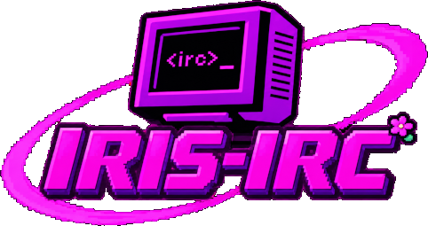

# IRIS-IRCd 

IRIS Internet Reley Chat Daemon
<p align="center">

  

</p>

<p align="center">
  <code>IRC Client →  IRIS IRCd + IRIS S2S Disturbed NETWORK PROTOCOL </code>
</p>

---

## Mikä on IRIS IRC?

IRIS on alusta asti itse rakennettu **Node.js-pohjainen IRC-palvelinohjelmisto**,

Perinteinen IRC-protokolla toimii IRISissä **yhteensopivuusrajapintana IRC-asiakasohjelmille**,
jotta IRC-clientit, kuten irssi, WeeChat ja HexChat, voivat muodostaa yhteyden IRIS-palvelimeen ilman erillistä IRIS-clientiä.

Palvelinten välinen hajautetunverkon liikenne perustuu puolestaan projektia varten suunniteltuun **omaan IRIS-S2S-protokollaan**.

## Arkkitehtuuri


```text
                                      IRC CLIENTS
                         ┌─────────────────────────────────┐
                         │                                 │
                         │  HexChat   irssi   WeeChat      │
                         │  Web IRC   Bots   Services      │
                         │                                 │
                         └───────────────┬─────────────────┘
                            │
                            │
              ┌─────────────┼─────────────┐
              │             │             │
          Direct TCP     TLS / SSL    SSH Tunnel
              │             │             │
              │             │        SSH → TCP
              │             │        forwarding
              └─────────────┼─────────────┘
                            │
                            ▼
┌──────────────────────────────────────────────────────────────────────────────┐
│                              IRIS IRCd                                       │
│                                                                              │
│                         Classic IRC Protocol                                 │
│                                                                              │
│  ┌────────────────────────────────────────────────────────────────────────┐  │
│  │                         NETWORK LAYER                                  │  │
│  │                                                                        │  │
│  │  TCP Listener → Connections → Sessions → Connection Lifecycle          │  │
│  └────────────────────────────────┬───────────────────────────────────────┘  │
│                                   │                                          │
│                                   ▼                                          │
│  ┌────────────────────────────────────────────────────────────────────────┐  │
│  │                         IRC PROTOCOL                                   │  │
│  │                                                                        │  │
│  │ Parser → Validation → Command Router → Command Handler → Serializer   │  │
│  │                                                                        │  │
│  │ NICK USER JOIN PART PRIVMSG NOTICE MODE QUIT ...                      │  │
│  └────────────────────────────────┬───────────────────────────────────────┘  │
│                                   │                                          │
│                                   ▼                                          │
│  ┌────────────────────────────────────────────────────────────────────────┐  │
│  │                              CORE                                      │  │
│  │                                                                        │  │
│  │ Users · Nicknames · Channels · Permissions                            │  │
│  │ Sessions · Membership · Modes · Server State                          │  │
│  │                                                                        │  │
│  │                    CORE OWNS SERVER STATE                              │  │
│  └────────────────────────────────┬───────────────────────────────────────┘  │
│                                   │                                          │
│                              Domain Events                                   │
│                                   ▼                                          │
│  ┌────────────────────────────────────────────────────────────────────────┐  │
│  │                           EVENT BUS                                    │  │
│  │                                                                        │  │
│  │ connection · user.created · nick.changed · channel.joined              │  │
│  │ message.sent · user.quit · channel.changed · server.connected           │  │
│  └──────────────┬─────────────────┬─────────────────┬─────────────────────┘  │
│                 │                 │                 │                        │
│                 ▼                 ▼                 ▼                        │
│          ┌──────────────┐  ┌──────────────┐  ┌──────────────────────────┐    │
│          │   SERVICES   │  │ OBSERVABILITY│  │       IRIS S2S            │    │
│          │              │  │              │  │                          │    │
│          │ NickServ     │  │ Logging      │  │ Link Manager             │    │
│          │ ChanServ     │  │ Metrics      │  │ S2S Connections           │    │
│          │ Oper/Admin   │  │ Telemetry    │  │ IRIS Protocol            │    │
│          │ Future       │  │ Health       │  │ Handshake                 │    │
│          └──────────────┘  └──────────────┘  │ Authentication             │    │
│                                              │ Capability negotiation     │    │
│                                              │ Sync / Routing             │    │
│                                              └──────────────┬────────────┘    │
└─────────────────────────────────────────────────────────────┼────────────────┘
                                                              │
                                                              │ IRIS Protocol
                                                              ▼
                              ┌───────────────────────────────────────────────┐
                              │                 IRIS NETWORK                  │
                              │                                               │
                              │       ┌────────────┐      ┌────────────┐      │
                              │       │  IRIS IRC  │◄────►│  IRIS IRC  │      │
                              │       │  SERVER A  │ IRIS│  SERVER B  │      │
                              │       └──────┬─────┘      └──────┬─────┘      │
                              │              │                    │           │
                              │              │       IRIS        │           │
                              │              └──────────┬─────────┘           │
                              │                         ▼                     │
                              │                  ┌────────────┐               │
                              │                  │  IRIS IRC  │               │
                              │                  │  SERVER C  │               │
                              │                  └────────────┘               │
                              └───────────────────────────────────────────────┘

                     PERSISTENCE / INFRASTRUCTURE (Tulevaisuudessa)
                                  │
             ┌────────────────────┼────────────────────┐
             │                    │                    │
             ▼                    ▼                    ▼
      ┌─────────────┐      ┌─────────────┐      ┌─────────────┐
      │ PostgreSQL  │      │    Redis    │      │  Metrics /  │
      │             │      │             │      │  Telemetry  │
      │ Persistent  │      │ Cache /     │      │             │
      │ State       │      │ Temporary   │      │ Health /    │
      │             │      │ State       │      │ Performance │
      └─────────────┘      └─────────────┘      └─────────────┘

```

## LISENSSI

- [LICENSE](./LICENSE)